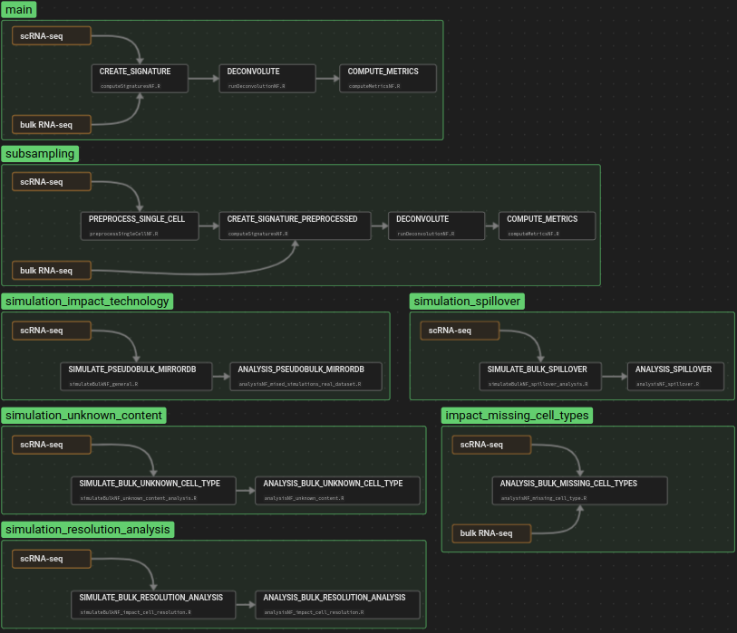

# deconvBench: a nextflow pipeline to benchmark second-generation deconvolution methods using omnideconv

For our effort to benchmark second-generation deconvolution methods, most of them included in [omnideconv](https://github.com/omnideconv/omnideconv), we implemented a nextflow pipeline that includes several workflows. These offer various simulation scenarios and the option to deconvolve real bulk RNA-seq datasets, all with different scRNA-seq datasets, deconvolution methods and other parameters.
A detailed description of the parameters and workflows follows below.

## Dependencies

All method-related dependencies are installed in an included Docker image, that you can either build yourself using the Dockerfile in the directory above (`docker/`) or pull directly from [Dockerhub](https://hub.docker.com/repository/docker/alexd13/omnideconv_benchmark/general).
*Note:* We currently only provide a Docker image for Linux based systems, MacOS and Windows are not supported. Users working on those operating systems have to install omnideconv manually.

In case you are working on a setup that does not allow the use of Docker, you can also switch to Apptainer (assuming it is already installed) by translating the Docker image to an Apptainer image like this:
```
docker pull alexd13/omnideconv_benchmark:latest
apptainer build /location/of/new/image/omnideconv_benchmark.sif docker-daemon://alexd13/omnideconv_benchmark:latest
```
Then adapt the path in the Apptainer profile of `nextflow.config` to the one specified above (i.e. `/location/of/new/image/omnideconv_benchmark.sif`) and use the 'apptainer' profile when running the pipeline. `docker/docker_to_singularity.sh` does both steps. `docker/add_secret.sh` creates an image with the method SECRET from the standard image. `docker/update_rectangle.sh` creates a new rectangle image from an existing one with another version of rectanglepy.

### Images

The methods run in four images; the profiles of `conf/norm.config` select the image of each method.

| Image | Methods | Docker | Apptainer (`.sif`, GitHub container registry) |
|---|---|---|---|
| standard 2.0 | bayesprism, bisque, cibersortx, dwls, music, music-hc, scaden, scdc; simulations and the reference split | `alexd13/omnideconv_benchmark:2.0` | `oras://ghcr.io/omnideconv/deconvbench-images:standard-2.0` |
| autogenes 1.3 | autogenes | `alexd13/omnideconv_benchmark:1.3` | `oras://ghcr.io/omnideconv/deconvbench-images:autogenes-1.3` |
| rectangle 2.5 | rectangle (rectanglepy 1.7.0) | - | `oras://ghcr.io/omnideconv/deconvbench-images:rectangle-2.5` |
| secret 2.4 | secret (standard image plus SECRET) | - | `oras://ghcr.io/omnideconv/deconvbench-images-secret:2.4` (private) |

Pull an image with e.g. `apptainer pull standard.sif oras://ghcr.io/omnideconv/deconvbench-images:standard-2.0`. The SECRET image is kept private because the SECRET repository states no licence; build it yourself with `docker/add_secret.sh`, or log in with `apptainer registry login --username <github user> oras://ghcr.io` (a GitHub token with `read:packages`) if you have access. CIBERSORTx itself runs in its own Docker image (see [CIBERSORTx](#cibersortx)). `docker/push_ci_images.sh` builds the `.sif` files from the sandboxes on our cluster and pushes them.

With Apptainer, the directories that hold your data, your results and the Nextflow work directory have to be bound into the container (`apptainer.runOptions = '--bind ...'`), because tasks read the outputs of other tasks from the work directory.

In addition, to run the pipeline you need an installation of [nextflow](https://www.nextflow.io/) (tested with version 25.10).

## Quickstart

If you want to deconvolve two bulk RNA-seq datasets (`bulk1` and `bulk2`) using one scRNA-seq dataset (`sc1`) and compute quality metrics for four selected deconvolution methods (`AutoGeneS`,`DWLS`,`MuSiC` and `Scaden`), you can start the pipeline like this:

```
nextflow -C pipeline/nextflow.config run pipeline/main.nf -profile docker
```

The `nextflow.config` file can then look something like this:

```
params {
    data_dir_bulk = "/user/benchmarking/datasets/bulks"
    data_dir_sc = "/user/benchmarking/datasets/single_cell"
    results_dir_general = "/user/benchmarking/results"

    single_cell_list = ["sc1"]
    bulk_list = ["bulk1","bulk2"]
    method_list = ["autogenes", "dwls", "music", "scaden"]

    ncores = '4'
}

profiles {
    docker {
        docker.enabled = true
        process.container = 'omnideconv_benchmark:1.0'
        // add more parameters regarding e.g. memory usage here
    }
}

```
Input files generally are placed in the two folders `data_dir_bulk` (for bulk mixtures) and `data_dir_sc` (for scRNA-seq references). The bulk datasets and scRNA-seq annotations we used during the omnideconv benchmarking efforts can be found at https://figshare.com/projects/deconvData/197794. The count matrices of the references should be accessed individually from the original data sources and can be preprocessed like we describe in our omnideconv benchmarking manuscript. A small example dataset (`sc1`, `bulk1`, `bulk2`) is included in `data/`.
Running the pipeline with the above configuration will expect the following folder structure:


```
user
└── benchmarking
    ├── datasets
    │   ├── bulks
    │   │   ├── bulk1
    |   |   |   ├── bulk1_counts.rds
    |   |   |   ├── bulk1_tpm.rds
    |   |   |   └── bulk1_facs.rds
    │   │   └── bulk2
    |   |       └── ...
    │   └── single_cell
    │       └── sc1
    │           ├── batch.rds
    │           ├── celltype_annotations.rds
    │           ├── matrix_counts.rds
    │           └── matrix_norm_counts.rds
    ├── results
    │
    └── DECONVBENCH
        ├── docker
        ├── pipeline
        │   ├── nextflow.config
        │   ├── main.nf
        │   ├── optimal_normalizations.csv
        │   ├── ...
        └── visualisation
```
You can find information on how the individual files have to look like [below](#input-formats).

## Structure of the pipeline

```
pipeline
├── main.nf                      the workflows
├── functions.nf                 helper functions that build the input channels of the processes
├── modules/local/               one file per process
├── bin/                         the R scripts that the processes run; utils.R holds shared functions
├── optimal_normalizations.csv   one row per method: normalizations and what its signature is built from
├── sc_datasets_technologies.csv sequencing technology of the scRNA-seq datasets (used for CIBERSORTx)
├── assets/                      celltype_aggregation.csv: cell-type sums needed for some bulk datasets
├── nextflow.config              template configuration
├── conf/ configs/ scripts/      configuration and launcher of our own cluster (see below)
└── tests/                       regression tests
```

Every process takes its datasets as input files and writes its results into its task directory; Nextflow then publishes them into the result directories. Because of this, `-resume` can be used safely: a task is run again if one of its input files changed, also if a file was replaced inside a dataset directory.

The processes are called directly from the workflows in `main.nf` and not through sub-workflows (the only exception is the optional [reference split](#reference-split-by-donor-or-by-cell)). This keeps the process names in the trace files short (e.g. `subsampling:DECONVOLUTE`), which `visualisation/supplement/fig_s4.Rmd` relies on. For the same reason the argument order of `computeSignaturesNF.R` and `runDeconvolutionNF.R` should not be changed.

## Workflows

This is a basic overview of the workflows that are offered in this pipeline. The parameters can be adapted in the `nextflow.config` file and are described below.

The workflows **impact_missing_cell_types**, **simulation_unknown_content**, **simulation_resolution_analysis** and **simulation_impact_technology** downsample the reference of the methods to at most 500 cells per cell type (`subset_cells` in `bin/utils.R`, seed 22); the resolution analysis does so per fine cell type. The **main**, **simulation**, **deconv_only** and **simulation_spillover** workflows use the reference as it is.



### main
The **main** workflow is run by using nextflow without the `-entry` parameter.


This workflow does signature creation, deconvolution and result metric calculations on the selected deconvolution methods (`method_list`) and datasets (`single_cell_list`, `bulk_list`).

In the **main** workflow following processes are run:
1. CREATE_SIGNATURE - Creates the signature matrix (or model) from the scRNA-seq datasets set in `single_cell_list`. How often this runs depends on the method, see [Methods](#methods): once per scRNA-seq dataset, once per combination of scRNA-seq and bulk dataset, or not at all.
2. DECONVOLUTE - Deconvolves the bulk RNA-seq datasets set in `bulk_list` using the created signature matrices.
3. COMPUTE_METRICS - Calculates the metrics for the deconvolution results. A bulk dataset without ground truth (`<bulk>_facs.rds`, e.g. a tumour cohort) is deconvolved, but has no metrics; the run prints a warning for it.

The results of the **main** workflow are stored in the `results_dir_general` directory, one folder per combination of method, scRNA-seq dataset and bulk dataset (see [Results](#results)).

The **deconv_only** workflow (`-entry deconv_only`) runs the first two steps only.

### simulation
The **simulation** workflow is run by using nextflow with the `-entry simulation` parameter.

It is the **main** workflow on simulated bulk datasets: SIMULATE_BULK creates one pseudo-bulk dataset with SimBu for each combination of `simulation_sc_dataset`, `simulation_n_cells`, `simulation_n_samples`, `simulation_scenario` and `simulation_bias_type`. These are then deconvolved with the scRNA-seq datasets in `single_cell_list`. The simulated datasets are also stored in `data_dir_bulk`. The scRNA-seq datasets in `simulation_sc_dataset` need a file `simbu_ds.rds` with their SimBu dataset.

### subsampling
The **subsampling** workflow is run by using nextflow with the `-entry subsampling` parameter.


This workflow shows how the methods and their resource usage scale with the size of the scRNA-seq reference. The size of the subsets and the number of replicates can be controlled by the parameters `ct_fractions` and `replicates`.

In the **subsampling** workflow following processes are run:
1. PREPROCESS_SINGLE_CELL - For each scRNA-seq dataset in `single_cell_list` the dataset is subsampled. The number of replicates is controlled by the `replicates` parameter. Cells are drawn randomly without replacement. The subsampled datasets are also stored in `preProcess_dir`.
2. SIMULATE_BULK - Creates the pseudo-bulk datasets (scenario `random`) from `simulation_sc_dataset`.
3. CREATE_SIGNATURE_PREPROCESSED - Creates signature matrix from the subsampled scRNA-seq datasets. In this workflow a signature is built for every bulk dataset and every method, so that the resources of this step can be reported per bulk dataset.
4. DECONVOLUTE - Deconvolves the simulated bulk RNA-seq datasets using the created signature matrices.

The results of the **subsampling** workflow are stored in the `results_dir_general` directory. Use `-with-trace` to record the resource usage of each task.

### impact_missing_cell_types
The **impact_missing_cell_types** workflow is run by using nextflow with the `-entry impact_missing_cell_types` parameter.


This workflow excludes cell types from the scRNA-seq datasets (`single_cell_list`) and then deconvolves the bulk RNA-seq datasets(`bulk_list`) using the created signature matrices. The cell types to be excluded are controlled by the `cell_types_to_exclude` parameter. The workflow is repeated for each cell type in the list, where each time one cell type is excluded. `"-"` stands for a run in which no cell type is excluded.

With `simulation_missing_cell_types = true` the workflow also simulates pseudo-bulk datasets (SIMULATE_BULK, with the same `simulation_*` parameters as the **simulation** workflow) and analyses them together with the datasets of `bulk_list`. A copy of the pseudo-bulk datasets is stored in `<preProcess_dir>/pseudo_bulk_missing_cell_types`.

In the **impact_missing_cell_types** workflow following process is run:
1. ANALYSIS_BULK_MISSING_CELL_TYPES - Excludes `cell_types_to_exclude` cell types from the `single_cell_list` scRNA-seq datasets and deconvolves the bulk RNA-seq datasets using the created signature matrices. Finally, the metrics for the deconvolution results are calculated. The cell type is removed before the reference is downsampled to 500 cells per cell type, so the other cell types with more than 500 cells get a different subsample in every run.

The results of the **impact_missing_cell_types** workflow are stored in the `results_dir_missing_cell_types` directory.

### simulation_unknown_content

The **simulation_unknown_content** workflow is run by using nextflow with the `-entry simulation_unknown_content` parameter.


This workflow simulates the presence of an unknown cell type in bulk RNA-seq datasets. The unknown cell type is controlled by the `unknown_cell_type` parameter.

In the **simulation_unknown_content** workflow following processes are run:
1. SIMULATE_BULK_UNKNOWN_CELL_TYPE - Creates simulated bulk RNA-seq datasets from `simulation_sc_dataset` with the presence of `unknown_cell_type`. The fraction of the unknown cell type is controlled by the `fractions_unknown_cells` parameter. The number of replicates is controlled by the `replicates_unknown_content` parameter.

2. ANALYSIS_BULK_UNKNOWN_CELL_TYPE - Creates signature matrices using the `known_cell_types` of the same scRNA-seq dataset and deconvolves the simulated bulk RNA-seq datasets using the created signature matrices.

The results of the **simulation_unknown_content** workflow are stored in the `results_dir_unknown_content` directory.


### simulation_impact_technology

The **simulation_impact_technology** workflow is run by using nextflow with the `-entry simulation_impact_technology` parameter.

In this workflow we evaluate the impact of differences in tissue origin and sequencing technology on deconvolution results.

In the **simulation_impact_technology** workflow following processes are run:
1. SIMULATE_PSEUDOBULK_MIRRORDB - For the datasets in `sc_datasets_impact_technology` we first identify all common cell types across datasets. Then we create as many pseudobulk replicates as specified in `replicates_simulation`; simulations are created using the 'mirrordb' scenario in SimBu, which matches the cell type fractions from the single-cell dataset to the pseudobulk.

2. ANALYSIS_PSEUDOBULK_MIRRORDB - Using each dataset in `simulation_sc_dataset` as reference, the previously created pseudobulks of every dataset are deconvolved. This means that you can add datasets from different technological backgrounds and see how they differently perform during deconvolution of the same pseudobulks.

3. ANALYSIS_BULK_MIRRORDB - The same references are used to deconvolve the real bulk datasets in `bulk_impact_technology`.

The results of the **simulation_impact_technology** workflow are stored in the `results_dir_impact_technology` directory.

### simulation_resolution_analysis

The **simulation_resolution_analysis** workflow is run by using nextflow with the `-entry simulation_resolution_analysis` parameter.

This workflow assesses the impact of using single cell atlases with different levels of cell type annotations. The scRNA-seq datasets in `simulation_sc_dataset` need the annotation files `celltype_annotations_normal.rds` and `celltype_annotations_fine.rds`, optionally `celltype_annotations_coarse.rds`, and a table `cell_type_mappings.csv` with the columns `Fine`, `Normal` and `Coarse` that maps the cell types of the levels to each other.

In the **simulation_resolution_analysis** workflow following processes are run:

1. SIMULATE_BULK_RESOLUTION_ANALYSIS - Pseudobulks are created by using different levels of annotation granularity.

2. ANALYSIS_BULK_RESOLUTION_ANALYSIS - Using each level of annotation, the single-cell reference is used for deconvolution of the previously simulated samples


The results of the **simulation_resolution_analysis** workflow are stored in the `results_dir_resolution` directory.


### simulation_spillover


The **simulation_spillover** workflow is run by using nextflow with the `-entry simulation_spillover` parameter.

This workflow assesses the erroneous prediction of a cell type caused by the occurrence of cell types with similar transcriptional profiles.

In the **simulation_spillover** workflow following processes are run:

1. SIMULATE_BULK_SPILLOVER - For each cell type in `spillover_celltypes` a set of pseudobulks is created from `simulation_sc_dataset`, where only cells from this cell type are sampled from the single-cell dataset ('pure' scenario in SimBu). The scRNA-seq dataset needs a file `simbu_ds.rds` with its SimBu dataset.

2. ANALYSIS_SPILLOVER - The previously simulated samples are deconvolved using the scRNA-seq datasets in `single_cell_list`

The results of the **simulation_spillover** workflow are stored in the `results_dir_spillover` directory.


## Parameters

Parameters can be changed in the `nextflow.config` file.

### Input Directories

| Name       | Type   | Description                             | Example                      |
| ---------- | ------ | ---------------------------------- | -------------------------------- |
| `data_dir_bulk` | path | absolute path to directory that contains RNA-seq datasets | `/path/to/datasets/` |
| `data_dir_sc` | path | absolute path to directory that contains scRNA-seq datasets                          | `/path/to/other/datasets/`          |

A dedicated description of the input file formats can be found [below](#input-formats).

### Output Directories

| Name       | Type   | Description                             | Example                      |
| ---------- | ------ | ---------------------------------- | -------------------------------- |
| `results_dir_general` | path | absolute path to directory in which final results of the `main`, `simulation` and `subsampling` workflow are stored | `/path/to/results/` |
| `preProcess_dir` | path | absolute path to directory in which subsampled scRNA-seq datasets and simulated pseudo-bulks of the analysis workflows are stored                          | `/path/to/temporary/directory/`          |

### General Parameters

| Name       | Type   | Description                             | Example                      |
| ---------- | ------ | ---------------------------------- | -------------------------------- |
| `ncores` | int | Number of cores that are available for methods | `4` |
| `species_sc` | string | Type of species in scRNA-seq dataset (`mm` or `hs`). Currently only supported by BayesPrism. | `hs` |

### Benchmarking Parameters [general]

| Name       | Type   | Description                             | Example                      |
| ---------- | ------ | ---------------------------------- | -------------------------------- |
| `single_cell_list` | [string] | list of scRNA-seq dataset names that will be used for deconvolution. Details for naming conventions are found [below](#input-formats). | `["hao-complete", "hao-sampled-3"]` |
| `bulk_list` | [string] |   list of RNA-seq dataset names that will be used for deconvolution. Details for naming conventions are found [below](#input-formats).                        |    `["finotello", "finotello-simulation"]`      |
| `method_list` | [string] |  list of method names that are used for deconvolution. Possible values are the methods in `optimal_normalizations.csv`: `["autogenes","bayesprism","bisque","cibersortx",` `"dwls","music","music-hc","rectangle","scaden","scdc","secret"]`                         |    `["music","bayesprism"]`       |
| `music_hc_marker_fraction` | float | optional, only for the method `music-hc`: share of the genes of a group that is used for the cell types inside the group (default 0.1) | `0.1` |
| `secret_with_unknown` | boolean | optional, only for the method `secret`: also estimate the proportion of cell types that are not in the reference (default `true`) | `true` |

### Simulation Parameters

These parameters describe the pseudo-bulk datasets of all workflows that simulate. Workflows other than `simulation` and `subsampling` expect a single value in `simulation_n_cells` and `simulation_n_samples`.

| Name       | Type   | Description                             | Example                      |
| ---------- | ------ | ---------------------------------- | -------------------------------- |
| `simulation_sc_dataset` | [string] | names of the scRNA-seq datasets in `data_dir_sc` from which pseudo-bulks are simulated | `["hao-complete"]` |
| `simulation_n_cells` | [int] | number of cells per pseudo-bulk sample | `[1000]` |
| `simulation_n_samples` | [int] | number of pseudo-bulk samples per dataset | `[5, 25, 50]` |
| `simulation_scenario` | [string] | SimBu scenario; used by the `simulation` workflow | `['mirror_db']` |
| `simulation_bias_type` | [string] | SimBu scaling factor (mRNA bias); used by the `simulation` workflow | `['expressed_genes']` |

### Reference split by donor or by cell

A workflow that simulates pseudo-bulks from the scRNA-seq dataset it also deconvolves with lets the same cells contribute to both. With `split_reference = true`, every dataset that has both roles (named in `simulation_sc_dataset` and in `single_cell_list`, or the one dataset of the **simulation_unknown_content** and **simulation_resolution_analysis** workflows) is split by donor: the cells of one part of the donors are used for the simulation, the cells of the other donors as reference of the methods. With `split_by = 'cell'` the cells are split within every cell type instead: no cell is used twice, but every donor can be in both parts. A dataset with only one role is used completely. The **impact_missing_cell_types** workflow is the exception: there the references are split whenever the split is on, also if no pseudo-bulks are simulated, so that the methods get the same part of the reference as in the other workflows. If `simulation_sc_dataset` is not set, the datasets of `single_cell_list` are used for the simulation.

| Name       | Type   | Description                             | Default                      |
| ---------- | ------ | ---------------------------------- | -------------------------------- |
| `split_reference` | boolean | split datasets that have both roles | `false` |
| `split_by` | string | `donor`: whole donors go to one part; `cell`: the cells of every cell type of the finest annotation level (`celltype_annotations_fine.rds` if the dataset has one) are split | `donor` |
| `split_fraction_simulation` | float | share of the donors whose cells go to the simulation, rounded to whole donors with at least one donor per part; with `split_by = 'cell'` the share of the cells of every cell type | `0.5` |
| `split_min_cells` | int | minimum number of cells that every cell type needs in each part, at every annotation level of the dataset | `50` |
| `split_min_cells_action` | string | what happens if a cell type has fewer cells: `error` stops the run, `warn` continues | `error` |
| `split_seed` | int | seed of the donor or cell assignment | `1` |
| `split_reference_cells_fraction` | float | share of the cells of the method part that is kept, drawn within every cell type; use it for datasets that are too large for the methods | `1` |

The donor of a cell is taken from `donor.rds` if the dataset has that file, otherwise from `batch.rds`. A dataset whose batches are several samples of the same donor needs a `donor.rds`.

The split is done by the process SPLIT_REFERENCE. Its description is stored in `<preProcess_dir>/reference_split/<dataset>_simulation<share>_mincells<n>_seed<seed>_cells<share>/` (with the suffix `_bycell` for `split_by = 'cell'`): the part of every cell (`assignment.csv`) and of every donor (`donors.csv`; for a split by cell the cells of every donor in each part), the cells per cell type in each part (`cells_per_cell_type.csv`) and the parameters. The same parameters give the same folder and the same content; other parameters give another folder.

### Workflow-specific Parameters:

The following sets of parameters are only used in the specified workflow.

####  workflow `subsampling`

| Name       | Type   | Description                             | Example                      |
| ---------- | ------ | ---------------------------------- | -------------------------------- |
| `ct_fractions` | [numeric] | This parameter influences how large the subsets are that are drawn from the scRNA-seq dataset: the total number of cells in the subset. The cell types keep their proportions, but each cell type keeps at least 20 cells (or all of its cells, if it has fewer). | `[1000, 5000, 25000]` |
| `replicates` | int | The number of technical replicates that are drawn from the scRNA-seq dataset. Repeats the subsampling with the indicated `ct_fractions` the indicated amount of times, in order to account for technical biases during random cell sampling. | `5` |


#### workflow `simulation_impact_technology`

| Name       | Type   | Description                             | Example                      |
| ---------- | ------ | ---------------------------------- | -------------------------------- |
| `results_dir_impact_technology` | path | absolute path to directory in which final results of the `impact_technology` workflow are stored | `/path/to/impact_technology/results/` |
| `replicates_simulation` | [int] | number of technical replicates for pseudo-bulk simulation | `[5]` |
| `sc_datasets_impact_technology` | [string] | names of scRNA-seq datasets in `data_dir_sc` whose common cell types are used, as one comma-separated string. Should contain the datasets in `simulation_sc_dataset`. | `["lambrechts,maynard"]` |
| `bulk_impact_technology` | [string] | names of real bulk datasets in `data_dir_bulk` that are deconvolved with each reference | `["vanderbilt_lung"]` |


#### workflow `simulation_spillover`

| Name       | Type   | Description                             | Example                      |
| ---------- | ------ | ---------------------------------- | -------------------------------- |
| `results_dir_spillover` | path | absolute path to directory in which final results of the `simulation_spillover` workflow are stored. | `/path/to/simulation_spillover/results/` |
| `spillover_celltypes` | [string] | Control, for which cell types the spillover analysis will be done. These cell types need to be present in the datasets used in `simulation_sc_dataset` and `single_cell_list`. | `["B cells","Monocytes","NK cells","T cells CD8","T cells CD4 conv"]` |

#### workflow `simulation_unknown_content`

| Name       | Type   | Description                             | Example                      |
| ---------- | ------ | ---------------------------------- | -------------------------------- |
| `results_dir_unknown_content` | path | absolute path to directory in which final results of the `simulation_unknown_content` workflow are stored | `/path/to/simulation_unknown_content/results/` |
| `known_cell_types` | [string] | subset of cell types that we will use to build the signature matrix, as one comma-separated string without spaces after the commas | `["B cells,Stromal cells,T cells CD4 conv,Macrophages"]` |
| `unknown_cell_type` | [string] | unknown cell type to use; currently only supports a single cell type | `["Tumor cells"]` |
| `fractions_unknown_cells` | [numeric] | How large the fraction of the unknown cell type is | `[0, 0.05, 0.1, 0.2, 0.3, 0.5, 0.7, 0.8, 0.9]` |
| `replicates_unknown_content` | [int] | number of technical replicates for pseudo-bulk simulation | `[5]` |

#### workflow `simulation_resolution_analysis`

| Name       | Type   | Description                             | Example                      |
| ---------- | ------ | ---------------------------------- | -------------------------------- |
| `results_dir_resolution` | path | absolute path to directory in which final results of the `simulation_resolution_analysis` workflow are stored | `/path/to/simulation_resolution_analysis/results/` |
| `cell_types_finer_res` | [string] | which cell types will we inspect at various resolutions? Names from the fine annotation, as one comma-separated string | `["Endothelial ACKR1, Endothelial RGS5, Endothelial CXCL12, CAFs MSC iCAF-like s1, ..."]` |
| `replicates_simulation` | [int] | number of technical replicates for pseudo-bulk simulation | `[5]` |

#### workflow `impact_missing_cell_types`

| Name       | Type   | Description                             | Example                      |
| ---------- | ------ | ---------------------------------- | -------------------------------- |
| `results_dir_missing_cell_types` | path | absolute path to directory in which final results of the `impact_missing_cell_types` workflow are stored | `/path/to/impact_missing_cell_types/results/` |
| `cell_types_to_exclude` | [string] | each of the cell types in the list will be a candidate for exclusion from the scRNA-seq dataset once; `"-"` excludes none | `["B cells","mDC","Monocytes","NK cells","T cells CD4 conv","-"]` |
| `simulation_missing_cell_types` | boolean | optional; `true` also analyses pseudo-bulk datasets simulated from `simulation_sc_dataset` with `simulation_n_cells`, `simulation_n_samples`, `simulation_scenario` and `simulation_bias_type` | `false` |

## Input Formats
The pipeline expects the input data to be in a specific format. The following sections describe the expected format for the scRNA-seq and bulk RNA-seq datasets.
### scRNA-seq datasets
- `batch.rds` - a character vector equal to the number of cells, indicating the batch of each cell.
- `donor.rds` - optional: a character vector equal to the number of cells with the donor of each cell. Only needed for the reference split by donor when the batches are not the donors.
- `celltype_annotations.rds` - a character vector equal to the number of cells, indicating the cell type of each cell.
- `matrix_counts.rds` - a matrix with the raw counts of each gene in each cell. Columns are cells, rows are genes. Is used by methods whose `sc_norm` is "*counts*".
- `matrix_norm_counts.rds` - a matrix with the normalized counts of each gene in each cell. Columns are cells, rows are genes. Is used by methods whose `sc_norm` is "*cpm*".

### bulk RNA-seq datasets
- `bulk_counts.rds` - a matrix with the raw counts of each gene in each sample. Columns are samples, rows are genes. Is used by methods whose `bulk_norm` is "*counts*". 'bulk' is a placeholder for the name of the bulk RNA-seq dataset, e.g. `finotello`.
- `bulk_tpm.rds` - a matrix with the TPM of each gene in each sample. Columns are samples, rows are genes. Is used by methods whose `bulk_norm` is "*tpm*".
- `bulk_facs.rds` - a matrix of true fractions for each cell type. Columns are samples, rows are cell types. Optional in the **main** workflow: without it no metrics are computed.

If the ground truth of a bulk dataset contains cell types that are sums of cell types in the reference (e.g. all T cells), add a row for it to `assets/celltype_aggregation.csv`.

## Results

The **main**, **simulation** and **subsampling** workflows write one folder per result into `results_dir_general`:

```
<method>_<sc dataset>_<sc_norm>_<bulk dataset>_<bulk_norm>_ct0_rep0
├── signature.rds                signature of the method (empty for methods without signature)
├── deconvolution.rds            estimated cell-type fractions
├── results_metric.rds           metrics, ground truth, estimated fractions and runtimes (main and simulation; only with a ground truth)
├── runtime_signature.rds
└── runtime_deconvolution.rds
```

In the **subsampling** workflow the folder name ends after `<bulk_norm>`. Some methods add files of their own (the DWLS marker tests, the Scaden model). The other workflows have their own layouts below their result directories.

The scripts in `visualisation/` read method and dataset names from these folder names, so the layout should stay as it is.

## Methods

`optimal_normalizations.csv` has one row per method:

| method       | sc_norm   | bulk_norm | signature_input |
|----|----|----|----|
|autogenes|cpm|tpm|none|
|bayesprism|counts|counts|none|
|bisque|counts|counts|none|
|cibersortx|cpm|tpm|sc|
|dwls|counts|tpm|sc|
|music|counts|tpm|none|
|music-hc|counts|tpm|none|
|scaden|counts|tpm|sc+bulk|
|scdc|counts|tpm|sc|
|rectangle|counts|tpm|none|
|secret|counts|counts|sc|

Each deconvolution method has a recommended set of normalization procedures, both for the scRNA-seq and bulk RNA-seq samples. Possible options currently are `counts` (un-normalized), `tpm` and `cpm`.

`signature_input` says what the signature of a method is built from, and with that how often CREATE_SIGNATURE runs in the **main**, **deconv_only** and **simulation** workflows:

- `sc` - from the scRNA-seq dataset only. The signature is built once per scRNA-seq dataset and used for all bulk datasets.
- `sc+bulk` - from the scRNA-seq and the bulk dataset. One signature per combination.
- `none` - the method does not build a signature. No signature task is run.

To add a method, add a row to this table and a branch for it in `signature_workflow_general` and `deconvolution_workflow_general` in `bin/utils.R`. A method that needs a setting from the config gets it through `methodSettings` in `functions.nf`, which passes it to the scripts as an optional last argument (see `music-hc` and `secret`).

### secret

`secret` is SECRET (Lu et al., NAR Genomics and Bioinformatics 2023, https://github.com/anlingUA/SECRET). It is not part of omnideconv and is called directly; it needs an image that contains the package (see `docker/add_secret.sh`; the repository of the package states no licence).

- **Signature.** Built once per scRNA-seq dataset, as described in the paper: marker genes of every cell type against all others (`Seurat::FindAllMarkers`, likelihood-ratio test, genes detected in at least 25 % of the cells of one group, log fold change of at least 0.25), a weight of 1 / number of cell types a gene is a marker of, and the mean expression of every cell type (`SECRET::scRefer`) as reference.
- **Unknown cell types.** By default SECRET also estimates the proportion of cell types that the reference does not contain: the result has an additional column `unknown`, and the proportions of the known cell types sum to at most 1. Set `secret_with_unknown = false` to switch this off; the known cell types then sum to 1.

### music-hc

`music-hc` is the hierarchical MuSiC (`music_prop.cluster`): it first estimates the proportions of groups of closely related cell types and then the proportions of the cell types inside each group.

- **Groups.** They are taken from the annotation levels of the scRNA-seq dataset: the cell types of `celltype_annotations.rds` are grouped by `celltype_annotations_coarse.rds` or, if that file is missing or does not group them, by `celltype_annotations_normal.rds`. A dataset without such a level cannot be used with `music-hc`; the task stops with a message. In the **simulation_resolution_analysis** workflow each level is grouped by the coarsest of the coarser levels; at the coarsest level every cell type is its own group, which gives the result of `music`.
- **Genes.** As in the MuSiC paper, genes with similar expression in the cell types of a group are used for the group proportions and the remaining genes for the cell types inside the group. The paper gives no threshold. Here, for each group, the 10 % of its expressed genes with the highest coefficient of variation between the cell-type means are used inside the group. Change the share with the parameter `music_hc_marker_fraction`. With few genes the step inside the groups can fail with a singular matrix (seen at 0.01 and 0.02 with lambrechts and at 0.1 with the fine annotation of wu). The share is then raised to 0.25 and, if needed, 0.5; the task log says so, and the share that was used is stored as attribute `marker_fraction` of the result.
- **Running it.** `music-hc` runs in the standard image. Add it to `method_list`, e.g. `profiles { apptainer { params.method_list = ["music","music-hc"] } }`.

## Tests

`tests/` contains a regression test that runs every workflow with every method on a small dataset and compares the result files with those of an earlier run:

```
Rscript tests/make_fixture.R data <fixture_dir>                  # inside the container; builds the test dataset from data/
tests/run_fixture.sh <fixture_dir> <run_dir>                     # runs all workflows
Rscript tests/compare_results.R <reference_run>/results <run_dir>/results
```

`tests/known_unstable.txt` lists result files with a known, explained difference. Scaden cannot be given a seed through omnideconv, so its results are only compared by structure. The profiles in `tests/conf/` are those of our cluster; adapt them to yours. `tests/conf_real/` and `tests/make_real_input.sh` run the same comparison on real datasets, `tests/replay_metrics.R` compares two versions of the metrics script on stored results, and `tests/check_trace_parsing.R` checks that a trace file can still be read by `fig_s4.Rmd`.

The configs in `tests/conf_split/` run the workflows with the reference split by donor (`CONF_DIR=tests/conf_split tests/run_fixture.sh <fixture_dir> <run_dir>`), those in `tests/conf_split_cell/` with the split within every cell type, and the profile `musichc` of the test configs runs the method `music-hc`.

### Continuous integration

`.github/workflows/ci.yml` tests the pipeline on GitHub after every push that changes `pipeline/`, `data/ci/` or the workflow file:

- **static** - `nextflow lint`, every run config of `configs/` with every profile, and a dry run (`-preview`) of all workflows.
- **workflows** - all eight workflows with MuSiC on the small dataset in `data/ci/` (built by `tests/ci/make_ci_fixture.R`), without split, split by cell and split by donor. `tests/ci/check_results.R` checks the results: complete estimates with the cell-type names of the reference, metrics only where there is a ground truth, unknown-content pseudo-bulks with only the known and the unknown cell types, ground truths of the resolution analysis with the names of the annotation, the split invariants, and MuSiC's values against `tests/ci/expected/`. `tests/ci/unit_tests.R` tests helpers such as the MuSiC-hc groups and SECRET's reference.
- **methods** - the main workflow with every method in its own image (standard, autogenes, rectangle, secret), when method code changed, for pull requests into `main` and when started by hand. CIBERSORTx is not tested in CI.

The test data contain the cases that broke runs on real data: annotations as factors with unused levels, a cell type from a single donor, names with `+`, `-`, `.`, `_` and names that contain each other, a bulk without ground truth and with non-integer counts, and a bulk named `hoek`.

The jobs pull the `.sif` files of the [images](#images) from the GitHub container registry. They log in with their `GITHUB_TOKEN`, so the repository needs read access to every private package (package settings, "Manage Actions access"). The same suites run on the cluster: `tests/ci/run_ci.sh <suite> <run_dir>` with `IMG_STANDARD`, `IMG_AUTOGENES`, `IMG_RECTANGLE` and `IMG_SECRET` pointing to the images. When results change on purpose, run the `workflows` suite and then `check_results.R workflows <run_dir> <pipeline_dir> --update-expected`. `tests/ci/check_mappings.R <dataset_dir> ...` checks the `cell_type_mappings.csv` of real datasets.

## Running on the DaisyBio cluster

Our own runs use the files in `conf/`, `configs/` and `scripts/`:

- `conf/norm.config` - the base config of the cluster: where the data are, the resources of the processes, and the profiles. There is one profile per container image, and each profile selects the methods that run in its image: `apptainer` (standard image; bayesprism, bisque, dwls, music, scaden, scdc), `autogenes`, `rectangle`, `secret`, and `cibersortx` (local Docker). Simulation, subsampling and the reference split always run in the standard image, so that all methods deconvolve the same simulated datasets with the same references. All Slurm jobs go to the `exbio-cpu` partition: AutoGeneS gives different results on `compms-cpu-1`, the other node of the default partition.
- `configs/<run>.config` - a run config: it includes the base config and then sets the parameters of one analysis. Everything defined in the base config can be overridden there, e.g. `data_dir_sc` or the memory of a method (`params.method_memory.dwls = 340`). To run only some of the methods of a profile, add `profiles { apptainer { params.method_list = ["dwls","scaden"] } }`. A workflow stops with a message if the run config does not set a parameter that it needs.
- `scripts/run.sh <config> <profile> [<workflow>] [nextflow options]` - starts a workflow, e.g. `scripts/run.sh nextflow_norm_resolution rectangle simulation_resolution_analysis -resume`.
- `scripts/run_profiles.sh <config> <workflow> [--check] [<profile> ...]` - runs one workflow with several profiles one after the other in one launch folder; `--check` runs only Bisque. `scripts/run_revision_*.sh` and `scripts/run_tcga_brca.sh` use it for the runs of the rectangle revision.
- Memory: with a large reference, set `ncores = 1` for DWLS. Its signature step runs one MAST worker per core, each with its own copy of the data (wu with 66,559 cells: 171 GB with one core, more than 480 GB with eight; see `configs/tcga_brca_dwls.config`).

Nextflow has to be started with Java 17 on this cluster (`run.sh` does this): with Java 21, copying a file larger than about 2 MB to one of the NFS shares never returns, which blocks the publishing of results.

## Additional Information

Method-specific minor points:

### CIBERSORTx

#### Credentials

CIBERSORTx requires users to use a token, that can be obtained from their website (https://cibersortx.stanford.edu/). In order to run CIBERSORTx with deconvBench, you need to enter your email and this token into the `cibersortx_credentials.csv` file, which will be read once CIBERSORTx is started. Do not commit this file with your token.

CIBERSORTx is started as a Docker container from inside the benchmark container. For this, the Docker socket and the Nextflow work directory have to be available in the benchmark container under the same paths as on the host (see the `docker` settings in `nextflow.config`).

#### Batch Correction

CIBERSORTx offers two batch correction modes, S-mode and B-mode, which should be used in different settings. The usecase depends upon the input dataset characteristics, both from the bulk and single-cell dataset.
If the bulk dataset has been simulated from the same single-cell dataset that will be used as reference, no batch correction should be used. If the bulk dataset originates from real samples, the batch correction depends on the technology of the single-cell dataset: In 10X-based dataset, S-mode should be used, in all other cases B-mode should be used.
The technology type of the single-cell dataset has to be added in the `pipeline/sc_datasets_technologies.csv` file, the correct naming convention for 10X-type datasets is simply `10X`, as given in the example. Every scRNA-seq dataset that CIBERSORTx uses as reference in the **main**, **simulation** and **deconv_only** workflows needs a row there, also while the modes are switched off; otherwise the deconvolution stops with `argument is of length zero`.

**Disclaimer:** During our benchmarking procedure, we were not able to use the B-mode from CIBERSORTx in its provided Docker container, as this ended with an error message that we could not influence. In the current version of the pipeline both modes are switched off for all datasets.
